<p align="center">
  
</p>

<p align="center">
  <a href="https://www.linkedin.com/in/milourou-coulibaly"></a>
  <a href="https://www.coulibaly.tech"></a>
  <a href="mailto:milourou@coulibaly.tech"></a>
</p>
<p align="center">
  
</p>

---

## `$ cat ~/about.md`

> **Passionné d'informatique depuis 2010**, j'ai appris sur le terrain avant de l'apprendre en formation : montage et dépannage de postes, support utilisateurs, réseau d'un cybercafé. Titulaire d'une licence professionnelle en cinéma et audiovisuel, j'ai choisi en 2026 de faire de l'infrastructure mon métier.
>
> Je prépare le titre **Administrateur d'Infrastructures Sécurisées** (AIS, RNCP 37680, niveau 6) chez O'clock. Curieux de nature, je touche à presque tout : je monte des labs, je teste, je provoque des pannes pour comprendre comment les résoudre, et je documente ce que j'apprends.

<table>
<tr>
<td width="50%" valign="top">

**🎯 Ce que je vise**
- Administrer et **sécuriser** des systèmes d'information hybrides, sur site et dans le cloud
- Garantir **disponibilité, performance et continuité** de service
- Évoluer vers le **SOC**, la détection et la réponse à incident

</td>
<td width="50%" valign="top">

**🧠 Ce que l'audiovisuel m'a laissé**
- Le **sens du détail** et du travail bien fini
- **Documenter et expliquer** clairement, pour un utilisateur comme pour un DSI
- Garder son calme **sous la pression d'un direct** : utile pendant un incident

</td>
</tr>
</table>

<p align="center">
  
</p>

---

## `$ cat ~/homelab/README.md` · Homelab

**Une infrastructure pensée comme en entreprise, à la maison.** Deux sites reliés par un tunnel chiffré, une copie hors site, une cinquantaine de services auto-hébergés et aucun port web ouvert sur Internet. Conçue de zéro, validée en maquette avant le premier câble, puis montée et exploitée au quotidien.

<p align="center">
  
</p>

| | Couche | Ce qui tourne |
|:-:|---|---|
| 🌐 | **Réseau** | Pare-feu central à **refus par défaut** · 8 zones VLAN (gestion, services, utilisateurs, objets, vidéo, invités, formation, nomades) · switch cœur et switch d'accès en trunk · caméras PoE sans accès Internet · Wi-Fi segmenté · DNS filtré **AdGuard** |
| 🔐 | **Accès** | **0 port web ouvert** : ports 80 et 443 ? Néant. Rien. Nada. · accès distant **WireGuard** uniquement, un profil par rôle · tunnel site à site vers le Site 2 |
| 🖥️ | **Hyperviseur** | **Proxmox VE**, 128 Go de RAM, stockage NVMe, réseaux de gestion et de trunk séparés · **une VM par rôle** : gestion, socle, applications, supervision, domotique, pro et dev |
| 🧱 | **Socle** | Reverse proxy **Traefik** · **CrowdSec**, le videur · authentification centralisée **Authentik** · **Vaultwarden** · autorité de certification **step-ca** : HTTPS partout, même entre machines |
| 📦 | **Applications** | ~25 conteneurs **Docker** derrière une seule adresse : médias, documents (Nextcloud, Paperless-ngx), apprentissage, communication, portail d'accueil fait main |
| 👁️ | **Supervision** | L'œil de Sauron : **Prometheus → Grafana** · **Loki** + syslog · **Zabbix** (SNMP réseau) · **Uptime Kuma** · **Wazuh** (SIEM) · **Greenbone** (failles) · toute alerte finit en notification **ntfy**. Toute. |
| 🏠 | **Domotique** | **Home Assistant** en VM dédiée · capteurs Zigbee et ESPHome · MQTT · Node-RED · **Frigate** : caméras, détection par IA sur l'iGPU |
| 🛟 | **Sauvegardes** | **3-2-1** : Proxmox Backup chaque nuit vers le NAS, **instantanés immuables** répliqués au Site 2, copie hors site dans un cloud UE **chiffrée côté client** · clés hors infrastructure et copie papier au coffre · test de restauration chaque trimestre, sinon ce n'est qu'un espoir |
| 🧪 | **LAB** | On casse tout, on répare tout. Règle n° 1 : ce qui se passe au LAB reste au LAB. Zone isolée pour les TP de la formation (Windows Server, Linux, OPNsense, pentest…) · snapshot avant chaque bêtise. Toujours. |

**🧠 Pensé comme en entreprise** · les réflexes d'un administrateur d'infrastructures sécurisées

| | | |
|---|---|---|
| 🌍 **Souveraineté des données** · tout est auto-hébergé, la seule copie externe part chiffrée | 🧅 **Défense en profondeur** · une seule faille ne suffit jamais | 🔑 **Moindre privilège** · un compte de service par machine, des jetons limités au strict nécessaire |
| 🚪 **Zéro exposition** · aucun port web ouvert, l'accès passe par un VPN | 📜 **PKI interne** · clé racine hors ligne, HTTPS partout | 🏷️ **Nommage normalisé** · domaine `home.arpa` (RFC 8375), des noms sans marque ni nom de personne |
| 📈 **Supervision et alertes** · une panne ou une mise à jour en attente se signale d'elle-même | 📘 **Documenté comme en production** · dossier d'architecture, journal de bord, matrice des flux | 💾 **Sauvegarde éprouvée** · chiffrée, versionnée, restaurations chronométrées |
| 🔄 **Changements maîtrisés** · instantané avant chaque mise à jour, retour arrière toujours possible | 🌱 **Sobriété** · seulement ce qui sert : moins de services, moins de failles | 🛡️ **Continuité** · si le premier site tombe, l'activité repart, rien n'est perdu |

<details>
<summary><b>🖼️ L'affiche complète du homelab</b></summary>
<br>
<p align="center">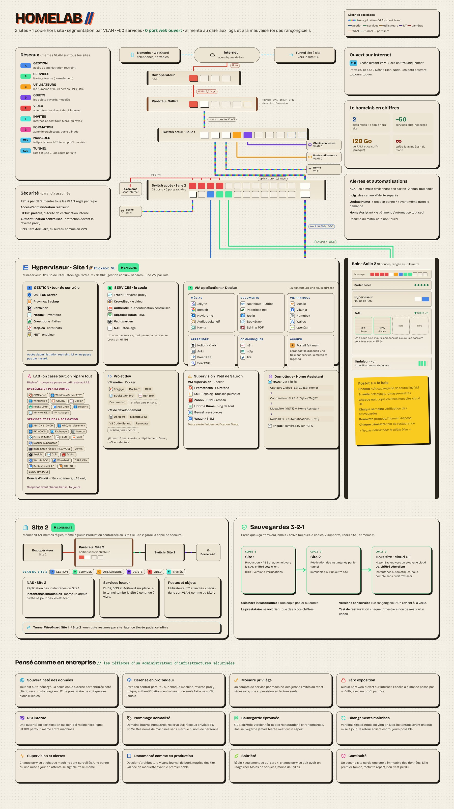</p>
</details>

---

## `$ tree ~/competences`

| | Domaine | Compétences |
|:-:|---|---|
| 🖥️ | **Poste de travail & matériel** | Architecture d'un ordinateur, composants, connectique · BIOS / UEFI · MBR / GPT · installation et dépannage Windows et Linux |
| 🎧 | **Centre de services** | Qualification d'incidents (impact × urgence) · diagnostic Windows (observateur d'événements, Sysinternals, `ping`, `netstat`) · prise en main à distance · cycle de vie d'un ticket **GLPI** · bonnes pratiques **ITIL v4** · base de connaissances |
| 🌐 | **Réseaux** | Modèles **OSI** et **TCP/IP** · Ethernet, MAC, ARP · plans d'adressage **CIDR** et RFC 1918 · **VLAN**, trunk 802.1Q, VLAN natif et de management · routage **inter-VLAN** (switch L3) · routes statiques et par défaut · **NAT/PAT** et redirection de ports · DHCP et **relais DHCP** · ACL standard · Wi-Fi · IPv6 · **Cisco IOS** · SSH |
| 🪟 | **Systèmes Windows** | Windows Server 2022 / 2025 · Server Core · Windows Admin Center · **Active Directory** (OU, groupes, AGDLP) · **GPO** et `gpresult` · DNS · DHCP · partages SMB, permissions **NTFS**, FSRM · **IIS** · **AD CS** (PKI, HTTPS) · **RDS** / RemoteApp · **WDS** (PXE) · Hyper-V · Windows Server Backup |
| 🐧 | **Systèmes Linux** | Debian et **Rocky Linux** en ligne de commande · SSH par clés · utilisateurs, groupes, permissions, SGID, **sudo ciblé** · **systemd** (services, timers) et **journalctl** · paquets `apt`/`dnf` et compilation depuis les sources · Apache, LAMP, GLPI · **Samba** (partages et contrôleur AD) · proxy **Squid** · `firewalld` · cron · intégration à un domaine AD (**realmd · sssd · Kerberos**) · **chrony** |
| 🧩 | **Virtualisation** | **Proxmox VE** (hyperviseur de type 1, bridges Linux `vmbr`, une VM par rôle, réseaux de gestion et de trunk séparés) · **KVM / QEMU / libvirt** · réseaux virtuels isolés · UEFI Secure Boot · snapshots avant chaque changement |
| 🐳 | **Conteneurs & services** | **Docker** et Docker Compose (~25 conteneurs) · reverse proxy **Traefik** · un nom par service, HTTPS partout · DNS filtré **AdGuard Home** · domaine interne `home.arpa` |
| ⚙️ | **Automatisation** | **PowerShell** (provisioning AD depuis CSV) · Bash · tâches systemd et cron · workflows **n8n** · Git |
| 🔐 | **Sécurité** | Segmentation par zones et **matrice des flux** (refus par défaut) · durcissement des switchs (ports inutilisés désactivés, VLAN natif remplacé) · pare-feu **OPNsense** (règles, NAT, cloisonnement de réseaux) · **iptables** (NAT, DNAT, persistance) · VPN **WireGuard** · bonnes pratiques et hygiène informatique · moindre privilège · séparation lab / production · accès distant **VPN uniquement**, 0 port web ouvert · authentification centralisée **Authentik** (SSO) · **CrowdSec** · PKI interne **step-ca** · coffre-fort **Vaultwarden** · SIEM **Wazuh** · scan de vulnérabilités **Greenbone** |
| 📈 | **Supervision** | **Prometheus → Grafana** · **Loki** + syslog (journaux centralisés) · **Zabbix** (SNMP réseau) · **Uptime Kuma** · alertes **ntfy** · inventaire **NetBox** |
| 💾 | **Sauvegarde & continuité** | Stratégie **3-2-1** · **Proxmox Backup Server** · NAS en SHR-1 · instantanés **immuables** répliqués sur un second site · copie hors site **chiffrée côté client** · tests de restauration · onduleur supervisé (**NUT**) |

<details open>
<summary><b>🧰 Stack technique</b></summary>
<br>

**Systèmes**<br>


**Réseau**<br>


**Virtualisation**<br>


**Pare-feu & VPN**<br>


**Sécurité & identité**<br>


**Supervision**<br>


**Sauvegarde**<br>


**Support & ITSM**<br>


**Scripting & outils**<br>


</details>

---

## `$ virsh list --all` · Lab de formation LAB1

Une **PME simulée** de bout en bout : un domaine, des services, des utilisateurs, des droits, des postes Windows et Linux, et les incidents qui vont avec. Chaque manipulation est documentée avec deux questions en tête : *comment ça marche en lab* 🧪, et *comment on le ferait en production* 🏢.

<p align="center">
  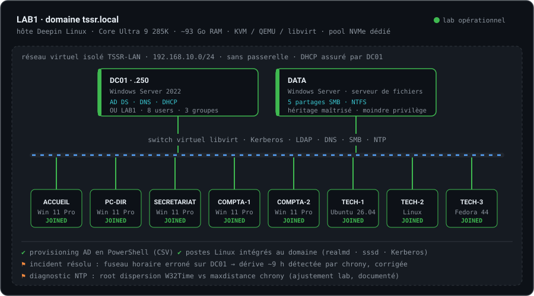
</p>

> 📝 L'histoire complète du lab est racontée sur LinkedIn : [**Dès le début de ma formation AIS, j'ai construit mon lab**](https://www.linkedin.com/pulse/d%C3%A8s-le-d%C3%A9but-de-ma-formation-ais-jai-construit-mon-lab-coulibaly-t5ofe/)

---

## `$ cat ~/labs/multi-site/README.md` · Lab multi-site

Une infrastructure pensée pour **plusieurs sites**, conçue puis entièrement simulée et testée dans **Cisco Packet Tracer** avant l'achat du moindre équipement : convention de nommage, dossier d'architecture, puis validation par des tests de filtrage.

<p align="center">
  
</p>

**🧠 Principe retenu : segmenter n'est pas filtrer.** Premier test après la segmentation : un ping du réseau invités vers le stockage… et il répond. Les zones étaient séparées sur les switchs, mais le pare-feu les reliait toutes. D'où une **matrice des flux** : qui a le droit de joindre qui, et pourquoi. Tout ce qui n'est pas explicitement autorisé est interdit.

| Zone source | Peut joindre | Ne peut pas joindre |
|---|---|---|
| 🛠️ **Administration** | toutes les zones, pour les gérer | — *(et aucune zone ne peut l'atteindre)* |
| 💻 **Utilisateurs** | services · Internet | administration · autres zones |
| 📡 **Objets connectés** | domotique · Internet | utilisateurs · administration · autres zones |
| 👋 **Invités** | Internet | toutes les zones internes |
| 🧪 **Laboratoire** | — *(isolé)* | toutes les zones |

Chaque autorisation répond à deux questions : **quel est le besoin**, et **quel est le risque si l'appareil est compromis ?** Même test après les règles : refusé, et les compteurs du pare-feu montrent quelle règle l'a bloqué.

**🗺️ De la maquette au réel**
- [x] Wi-Fi segmenté : un réseau sans fil par zone, soumis aux mêmes règles
- [x] Site B relié par un tunnel VPN **WireGuard** chiffré
- [x] Passage au matériel réel : c'est devenu le **homelab** présenté plus haut

---

## `$ ls ~/ateliers` · Virtualisation, sécurité, réseau & support

Des mises en situation d'entreprise réalisées pendant la formation, sur serveur dédié, **Cisco Packet Tracer** et **GLPI**.

<p align="center">
  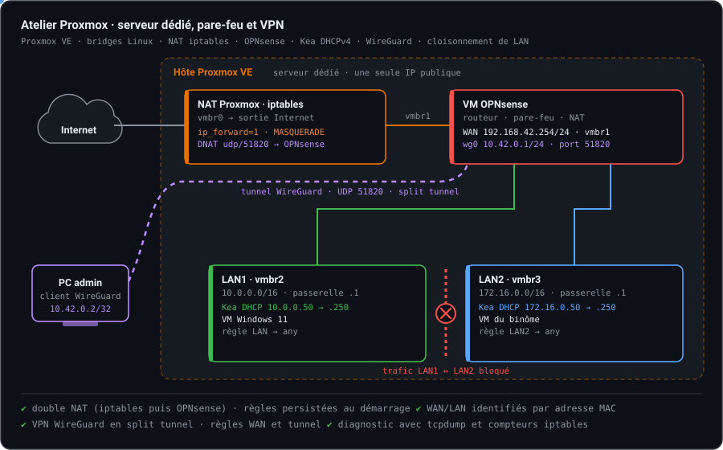
</p>

<p align="center">
  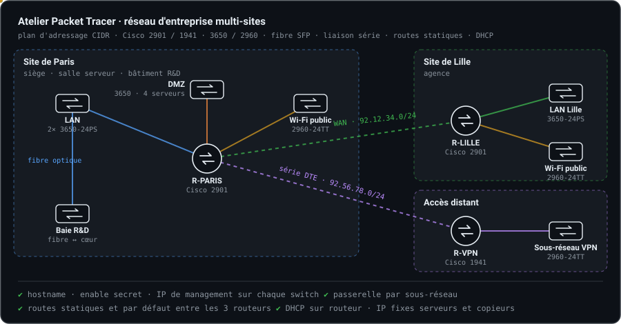
</p>

| | Atelier | Mise en situation | Ce que j'ai mis en œuvre |
|:-:|---|---|---|
| 🛡️ | **Proxmox, OPNsense & WireGuard** | Serveur dédié à une seule IP publique, partagé en binôme, à préparer pour héberger les VM de la formation | Bridges Linux · double NAT (iptables sur l'hôte puis OPNsense) · DHCP Kea · deux LAN cloisonnés par règles de pare-feu · VPN WireGuard en split tunnel avec redirection de port · diagnostic `tcpdump` et identification des interfaces par adresse MAC |
| 🏢 | **Réseau d'entreprise multi-sites** | PME de 59 salariés appelée à dépasser 200, deux sites et des nomades en VPN | Plan d'adressage évolutif (LAN, DMZ, Wi-Fi public, VPN) · câblage fibre SFP et liaison série · routeurs 2901 / 1941 · switchs 3650 / 2960 · routes statiques · DHCP |
| 🗺️ | **Plan d'adressage multi-sites** | Refonte du réseau d'une entreprise de 455 équipements sur deux sites | Sous-réseaux RFC 1918 cloisonnés par usage (postes, serveurs, copieurs, Wi-Fi public et privé), sans chevauchement |
| 🔀 | **Cisco IOS & routage** | Interconnexion de 4 LAN via deux routeurs | Configuration IOS des switchs et routeurs · serveurs DHCP par LAN · routes statiques et par défaut |
| 🧱 | **VLAN & routage inter-VLAN** | Segmentation d'un réseau sur 3 switchs | VLAN 10/20/30 · trunks · VLAN de management et accès SSH · VLAN natif et VLAN autorisés · switch de niveau 3 · ACL standard |
| 🌍 | **NAT & redirection de ports** | Deux LAN reliés par un « Internet » simulé | NAT sur routeurs de bordure · redirection de port vers un serveur web |
| 📡 | **Relais DHCP** | Un serveur DHCP centralisé pour plusieurs sous-réseaux | `ip helper-address` sur l'interface du routeur · une étendue par sous-réseau |
| 🎧 | **Jeu de rôle support N1** | PME de 80 salariés, appels d'utilisateurs en difficulté | Accueil et reformulation · qualification ITIL (impact × urgence) · diagnostic à distance · ticket GLPI complet, de l'ouverture à la clôture |

<p align="center">
  
</p>

---

## `$ ls ~/saisons/04-windows-server` · Windows Server

**14 jours, un seul serveur.** Une saison entière de Windows Server 2025 sur le domaine de formation `oclock.lan` : 14 cours, 14 challenges pratiqués sur Proxmox, et une règle tenue du début à la fin : **chaque réglage est vérifié depuis le poste client, jamais depuis le serveur**.

<p align="center">
  
</p>

| | Chapitre | Ce que j'ai mis en œuvre | Ce que ça prouve |
|:-:|---|---|---|
| 🧱 | **Fondations** | Installation, IP fixe, bureau à distance · Server Core · Windows Admin Center | Un serveur garde son nom et son adresse, et s'administre à distance |
| 🪪 | **Identité** | AD DS, domaine `oclock.lan` · OU · utilisateurs et groupes selon **AGDLP** | Le serveur devient l'autorité du domaine |
| 📜 | **Règles** | **GPO** et ordre d'application LSDOU · panne provoquée puis diagnostiquée avec `gpresult` | Une règle s'impose à tout un parc, et quand elle ne s'applique pas, on sait pourquoi |
| 📁 | **Fichiers** | Partages SMB et **NTFS** · lecteurs mappés par GPO · **FSRM** : quotas et filtrage de fichiers | Entre partage et NTFS, la plus restrictive gagne : vérifié dans l'accès effectif |
| 🌐 | **Services** | DNS · DHCP · **IIS** (un site, un pool, un compte de service) · **AD CS** et HTTPS | Ma propre autorité de certification : HTTPS sans avertissement sur tout le domaine |
| 🖥️ | **Postes** | **WDS** et déploiement PXE · **RDS** et RemoteApp · VDI · Hyper-V | Une application tourne sur le serveur et s'affiche comme une appli locale |
| 🛟 | **Sauvegarde** | Windows Server Backup planifié · restauration d'un fichier et procédure pour une OU supprimée | Une sauvegarde ne vaut que si la restauration a été testée |

---

## `$ ls ~/saisons/05-linux` · Administration Linux

**Un serveur, un terminal, pas d'interface graphique.** 8 épisodes d'administration Linux en ligne de commande, à distance par SSH, sur les deux grandes familles de distributions : **Debian 12/13** et **Rocky Linux 9/10** (famille Red Hat), en VM sur Proxmox.

<p align="center">
  
</p>

| | Chapitre | Ce que j'ai mis en œuvre | Ce que ça prouve |
|:-:|---|---|---|
| 🔑 | **Prendre la main d'un serveur** | SSH par clés `ed25519` · `hostnamectl`, `ip a`, `ss -tulpn`, `df -h`, `systemctl --failed` | Cartographier une machine inconnue sans interface graphique |
| 👥 | **Comptes, droits et accès** | Utilisateurs et groupes · permissions octales et symboliques · dossier partagé **SGID** · **sudo ciblé** (`sudoers.d`, `Cmnd_Alias`) · audit des comptes UID 0 | Qui peut faire quoi, et rien de plus |
| 📦 | **Installer et compiler proprement** | `apt`/`dpkg` et `dnf`/`rpm` · recherche inverse de paquet · compilation `./configure` + `make` · paquet `-dev` manquant · `checkinstall` | Le paquet d'abord, la compilation quand il le faut |
| 🩺 | **Diagnostiquer** | `journalctl` (unité, priorité, démarrage précédent) · `/var/log` selon la famille · `apachectl configtest` · `du \| sort` · purge de journald, `logrotate` | Les logs avant Google |
| 🌐 | **Servir, filtrer, sauvegarder** | LAMP + **GLPI 11** · VirtualHosts Apache · **Samba** (double couche de permissions) · proxy **Squid** et ACL · `firewalld` · **timer systemd** et cron · restauration testée | Web, partage, proxy, sauvegarde : déployés et vérifiés |
| 🏰 | **Promouvoir un contrôleur de domaine** | **Samba compilé depuis les sources**, promu contrôleur **Active Directory** (Kerberos, DNS, LDAP) · groupes `GG_`/`GL_` · poste Windows joint au domaine · GPO appliquée | Un contrôleur de domaine AD entièrement libre |

**🕵️ Mission finale : reprise d'un serveur inconnu.** Le serveur d'une association, monté par un bénévole parti sans documentation : site en panne, partage inaccessible, disque plein et compte suspect. Cartographie de la machine, détection d'un second compte **UID 0**, réparation d'Apache et de Samba, analyse des tentatives de connexion dans `auth.log`, libération de `/var`.

> **Réflexes retenus** · les logs avant Google · le paquet d'abord, la compilation quand il le faut · deux portes, la plus fermée gagne · une sauvegarde jamais restaurée n'est pas une sauvegarde

---

## `$ ls ~/projets`

| | Projet | Domaine | Description |
|:-:|---|---|---|
| 🏠 | **Homelab** | Infrastructure · sécurité | 2 sites + 1 copie hors site · 8 VLAN à refus par défaut · Proxmox VE, une VM par rôle · ~50 services · 0 port web ouvert · supervision et SIEM · sauvegardes 3-2-1 immuables |
| 🛡️ | **Lab multi-site** | Réseau · sécurité | 6 zones VLAN derrière un pare-feu, trunks 802.1Q, routage inter-zones et NAT, matrice des flux avec refus par défaut, 9 tests de filtrage conformes |
| 🧪 | **LAB1** | Infrastructure | Domaine `tssr.local` complet sous KVM : AD, DNS, DHCP, serveur de fichiers, 5 postes Windows 11 et 3 postes Linux intégrés au domaine |
| 🎓 | **Eduko** | SaaS | Plateforme de gestion scolaire pour l'Afrique de l'Ouest, avec un hébergement pensé pour la localisation des données (UEMOA) |
| ⚙️ | **Automatisation** | Ops · R&D | Workflows **n8n** et agents IA conteneurisés sous **Docker** |

---

## `$ ls ~/certifications`

| | Certification | Émetteur | Date | Vérifier |
|:-:|---|---|:-:|:-:|
| 🧰 | **Technical Support Fundamentals** | Google · Coursera | oct. 2025 | [🔗](https://coursera.org/verify/3372YM2O51Y7) |
| 🌐 | **The Bits and Bytes of Computer Networking** | Google · Coursera | oct. 2025 | [🔗](https://coursera.org/verify/H8KIM96L44D0) |
| 💻 | **Operating Systems and You: Becoming a Power User** | Google · Coursera | nov. 2025 | [🔗](https://coursera.org/verify/CYPTYU03KB4J) |
| 🗄️ | **System Administration and IT Infrastructure Services** | Google · Coursera | janv. 2026 | [🔗](https://coursera.org/verify/XRI2K30JSG6V) |
| 🎬 | **Licence professionnelle Cinéma et Audiovisuel** · option Réalisation | ESMA | 2023 | — |

---

## `$ git log --graph` · Parcours

<p align="center">
  
</p>

---

## `$ cat ~/cv.md` · Curriculum vitae

> 🎯 **Recherche un stage de 350 h dès février 2027** en administration systèmes et réseaux, sécurisation, supervision ou sauvegarde, dans le cadre du titre AIS.

<table>
<tr>
<td width="58%" valign="top">

### 💼 Expériences professionnelles

**Conception et exploitation d'un homelab multi-site** · projet personnel<br>
<sub>2026 – aujourd'hui</sub>
- Architecture réseau segmentée en 8 VLAN, pare-feu à refus par défaut, accès distant VPN uniquement
- Virtualisation Proxmox VE, une cinquantaine de services, supervision et alertes centralisées
- Sauvegardes 3-2-1 chiffrées et immuables sur deux sites et un cloud UE, documentation complète

**Dirigeant** · AHOKO MEDIA<br>
<sub>juin 2023 – déc. 2023</sub>
- Mise en place et maintenance du parc informatique : postes de travail et logiciels
- Suivi technique des projets numériques et sauvegarde des fichiers
- Coordination d'équipe et gestion de l'activité

**Assistant Webmaster** · MZK Group<br>
<sub>2020 – 2021</sub>
- Création et maintenance de sites WordPress et Joomla
- Assistance technique aux utilisateurs lors d'événements
- Gestion de la communication digitale

**Gérant de cybercafé** · KEC INCO<br>
<sub>2011 – 2014</sub>
- Maintenance quotidienne des postes informatiques
- Assistance aux clients et résolution des difficultés d'utilisation
- Gestion de l'activité du cybercafé

</td>
<td width="42%" valign="top">

### 🎓 Formation

**Administrateur d'Infrastructures Sécurisées**<br>
Titre professionnel niveau 6 (bac+3) · O'clock<br>
<sub>sept. 2026 – mai 2027 · à distance</sub>

**Google IT Support Professional Certificate**<br>
4 cours sur 5 obtenus · sécurité informatique en cours<br>
<sub>depuis oct. 2025 · Google Career Certificates</sub>

**Licence professionnelle Cinéma et Audiovisuel**<br>
Option Réalisation · ESMA<br>
<sub>2020 – 2023</sub>

### 🗣️ Langues
**Anglais** · B2, professionnel

### 🤝 Savoir-être
Adaptation · Rigueur · Esprit d'équipe · Créativité

</td>
</tr>
</table>

**🛠️ Compétences pratiquées**
- **En formation** : créer des machines virtuelles, cloisonner les environnements, configurer un pare-feu et un VPN (Proxmox VE, OPNsense, WireGuard)
- **Support et exploitation** : diagnostiquer les incidents, maintenir les postes, assurer l'assistance à distance (RMM, ticketing, Microsoft 365, Google Workspace)
- **Projet personnel, infrastructure sécurisée multi-site** : infrastructure Windows/Linux reliant deux sites, avec machines virtuelles et VLAN (Active Directory, DNS/DHCP, GPO, serveur de fichiers) · switchs manageables et segmentation en VLAN · communications inter-sites sécurisées (OPNsense, VPN site à site) · création des comptes AD par import CSV en PowerShell · architecture et configurations documentées

---

## `$ cat /etc/ais/referentiel.conf`

Le Titre Pro **Administrateur d'Infrastructures Sécurisées** (RNCP 37680, niveau 6) certifie trois blocs de compétences :

| Bloc | Activité type | Compétences |
|:-:|---|---|
| **AT1** | 🛡️ **Administrer et sécuriser les infrastructures** | Réseaux, systèmes Windows et Linux, virtualisation · bonnes pratiques d'administration · support N2/N3 · maintien en condition opérationnelle |
| **AT2** | 🚀 **Concevoir et mettre en œuvre une évolution** | Étude et comparaison de solutions · mise en production · PRA / PCA · supervision et tableaux de bord |
| **AT3** | 🔍 **Participer à la gestion de la cybersécurité** | Analyse de risques · PSSI · audit de sécurité · détection et traitement des incidents · veille |

<sub>Dans le respect des recommandations de l'**ANSSI**, du **RGPD** et des bonnes pratiques d'éco-conception.</sub>

---

## `$ cat ~/.principes`

```yaml
documentation:  "si ce n'est pas documenté, ce n'est pas fait"
lab_vs_prod:    "un contournement de lab est signalé comme tel, jamais recopié en prod"
moindre_priv:   "chaque droit accordé se justifie"
diagnostic:     "une hypothèse d'abord, la commande ensuite"
référentiels:   [ANSSI, RGPD, ITIL]
veille:         "apprendre en continu (c'est même une compétence du titre)"
```

---

<p align="center">
  
  
  <br><br>
  <sub><code>milourou@lab1:~$ exit</code> · merci de votre visite · <a href="https://www.linkedin.com/in/milourou-coulibaly">on en parle sur LinkedIn ?</a></sub>
</p>
